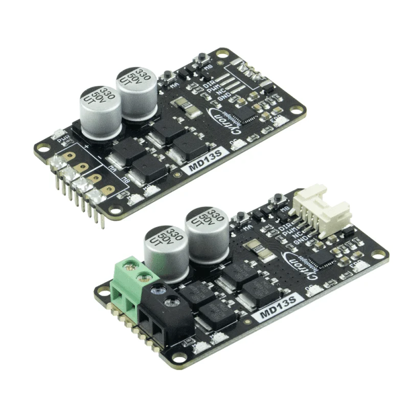
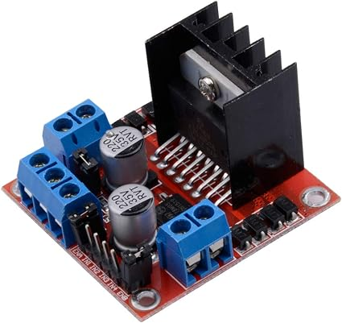
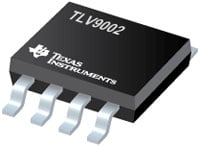
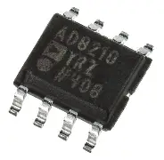
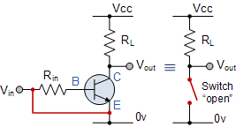
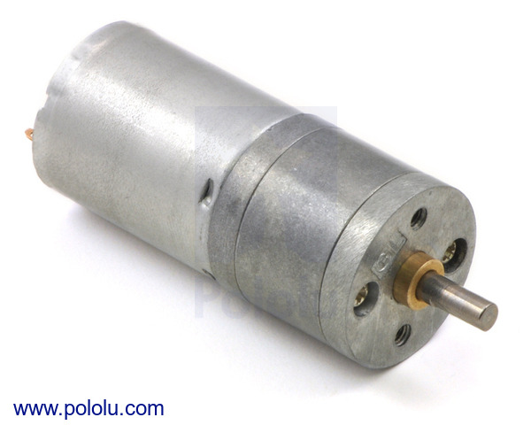
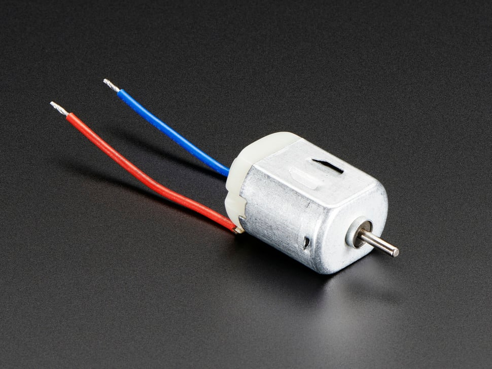
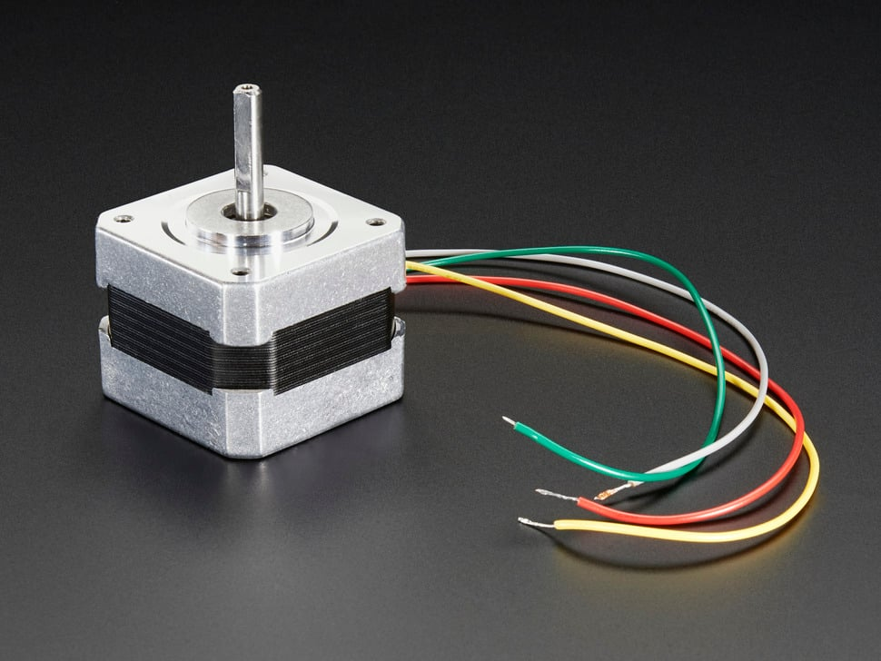

# Individual Component Selection Report

**Your Name:** Emmanuel Garcia  
**Your Assigned Module:** Board 2 – Grip Actuation Node  
**Course:** RAS 304 Embedded Systems Design

---

# Part 1: Major Component Selections

## Subsystem 1: Bidirectional H-Bridge

This subsystem translates logic-level PWM and direction signals from the microcontroller into high-current polarity-reversing drive paths for the DC Grip Actuator Motor and Lead-Screw assembly.

| Solution | Pros | Cons |
|---|---|---|
| **Option 1: Cytron MD13S Module** • Unit Cost: $15.30 • [Official Cytron MD13S Product Page](https://cytron.io)  | • High continuous current handling up to 13A easily covers motor stall conditions. • Through-hole header connections allow for easy prototyping and soldering. • Employs a full NMOS design that generates minimal operational heat. | • Physical module size takes up significant real estate inside a tight enclosure. • Large screw terminals add weight and layout bulk to the PCB design. • Unit cost is substantially higher than deploying discrete IC components. |
| **Option 2: L298N Dual H-Bridge Driver** • Unit Cost: $3.15 • [STMicroelectronics L298N on DigiKey](https://digikey.com)  | • Classic Multiwatt-15 package features wide, easy-to-solder through-hole pins. • Extensively documented with standard TTL logic interfaces. • Provides independent dual-channel architecture for driving secondary actuators if needed. | • Outdated bipolar transistor technology causes a high internal forward voltage drop. • Dissipates large amounts of waste energy entirely as heat, requiring a bulky external heatsink. • Inefficient power conversion reduces total battery efficiency. |
| **Option 3: Custom Discrete H-Bridge Circuit** • Unit Cost: $4.20 ~ • [Discrete H-Bridge Circuit Reference Design](https://electronics-tutorials.ws) | • Features fully customizable through-hole TO-220 power MOSFET profiles. • Ultra-low channel resistance minimizes thermal dissipation sink needs. • Maximizes physical placement paths on the custom printed board. | • Introduces a severe risk of destructive shoot-through short circuits if PWM control logic overlaps. • Requires an elevated discrete component count including independent gate-drivers and protection flyback diodes. • Greatly increases hardware debugging time if trace parasitics compromise switching speeds. |

### Final Selection for Subsystem 1: Option 1: Cytron MD13S Module

**Rationale:** The Cytron MD13S is selected as our optimal choice because its integrated NMOS design safely handles up to 13A continuously, making it completely immune to the high thermal stress and physical stall currents typical of our gripper's high-torque lead-screw assembly. While the L298N is cheaper, its outdated bipolar design drops significant voltage internally and generates excessive waste heat, which would require a heavy, space-wasting external heatsink. Furthermore, using this pre-certified module isolates high-current inductive switching noise away from our primary custom PCB routing layers.

---

## Subsystem 2: Current Sense & Overload Module

This module utilizes a low-side shunt setup to capture active motor current spikes and sets an immediate digital hardware alert flag using a dedicated comparator loop before a mechanical failure occurs.

| Solution | Pros | Cons |
|---|---|---|
| **Option 1: Texas Instruments TLV9002** • Unit Cost: $0.83 • [Texas Instruments TLV9002 Product Page](https://ti.com)  | • Dual rail-to-rail configuration fits both current shunt amplification and comparator roles simultaneously. • Integrated RFI and EMI filter circuitry limits motor switching noise injection. • Very low unit cost fits tight project budgets. | • Requires a complex external network of discrete tuning resistors to establish trip thresholds. • Surface-mount footprints can be challenging to hand-solder without breakout adapters. • Low 1MHz bandwidth bounds fast high-frequency peak tracking speeds. |
| **Option 2: Analog Devices AD8210** • Unit Cost: $7.85 • [Analog Devices AD8210 Current Shunt Page](https://analog.com)  | • High-precision dedicated architecture offers highly accurate shunt tracking capabilities. • Provides reliable handling of high common-mode voltage fluctuations during inductive kicks. • Minimizes additional hardware overhead requirements across analog trace paths. | • The component is primarily sold in surface-mount formats, requiring an assembly adapter board. • High baseline cost budget allocation for a basic current feedback interface function. • Lacks an integrated threshold comparator, necessitating a secondary IC component. |
| **Option 3: Custom Discrete BJT Threshold Switch** • Unit Cost: $0.35 ~ • [Discrete BJT Switching Tutorial](https://electronics-tutorials.ws)  | • Absolute lowest baseline components cost metric. • Dirt-simple routing architecture via basic components. • Avoids active operational amplifier chip allocations. | • Highly vulnerable to thermal drifts shifting trip thresholds. • Soft turn-on regions yield undefined transitional states. • High shunt drop voltage required to trigger base junction. |

### Final Selection for Subsystem 2: Option 1: Texas Instruments TLV9002

**Rationale:** The TLV9002 is selected because its dual rail-to-rail channels allow us to implement both the low-side current shunt amplification stage and the overcurrent threshold comparator loop using a single, highly cost-effective through-hole integrated circuit. This completely eliminates the extra component count, weight, and board complexity associated with separate packages. While the custom BJT switch circuit is cheaper, its trip threshold is highly sensitive to ambient thermal drift, risking accidental emergency-stop triggers during prolonged motor operation.

---

## Subsystem 3: DC Grip Actuator Motor

This subsystem provides the raw mechanical rotational torque required to drive the mechanical linkages, lead screw, and slider assembly for secure physical cargo clamping.

| Solution | Pros | Cons |
|---|---|---|
| **Option 1: Pololu 25D High-Torque Gearmotor** • Unit Cost: $19.95 • [Pololu 25D Metal Gearmotors Category](https://pololu.com)  | • Integrated steel heavy-duty spur gearbox provides immense mechanical advantage. • Compact 25mm outer diameter mounts easily inside custom structured grip configurations. • Direct face-mounting tapped holes ease concentric coupling setup. | • High stall currents generate immense inductive flyback spikes during motor reversals. • Mechanical brushes experience degradation over extended high-load duties. • Bare metal output shaft requires precision couplers to prevent mechanical binding. |
| **Option 2: Basic Hobby 130-Size DC Motor** • Unit Cost: $2.50 • [Brushed 130-Size DC Motors on DigiKey](https://digikey.com)  | • Low-profile design minimizes weight on the distal arm joints. • Dirt-cheap replacement procurement fits lean laboratory development cycles. • Simple two-wire input keeps connectivity issues basic. | • Pathetically low output holding torque cannot maintain heavy structural grasp vectors. • Extremely high loose-speed parameters require an external reduction assembly. • Thin plastic press-fit output shafts warp easily under axial side-loads. |
| **Option 3: Standard Size NEMA 17 Stepper Motor** • Unit Cost: $14.50 • [NEMA 17 Stepper Motors Lineup](https://digikey.com)  | • Delivers perfect, precise non-accumulating open-loop position profiling paths. • Eliminates the basic requirement for secondary external safety limit endstops. • Solid holding torque signatures lock structural positions firmly when unpowered. | • Severe weight penalty adds excessive stress to the vertical linkage arm structures. • Demands specialized complex phase-step driver indexing configurations instead of raw PWM lanes. • Heavy continuous power drain drops system battery charge rapidly even while idling. |

### Final Selection for Subsystem 3: Option 1: Pololu 25D High-Torque Gearmotor

**Rationale:** The Pololu 25D series gearmotor is chosen because its integrated metal reduction gearbox generates the high linear holding force required to drive our gripper's lead-screw configuration without back-driving or slipping under load. The 130-size motor does not offer enough mechanical advantage to secure objects, while a NEMA 17 stepper introduces too much structural weight and bulk for a distal robot node.

---

## Microcontroller Pin Mapping Table

| Microcontroller Pin | Subsystem Connection | Signal Direction | Signal Type | Functional Description |
|---|---|---|---|---|
| **RC0** | **Bidirectional H-Bridge** | OUTPUT | Digital (PWM) | Controls the speed of the motor via duty-cycle modulation |
| **RC1** | **Bidirectional H-Bridge** | OUTPUT | Digital (GPIO) | Sets motor directional polarity (High/Low) |
| **RA1** | **Current Sense Amp** | INPUT | Analog (ADC) | Monitors real-time current scaling for load profiling |
| **RE1** | **Overload Comparator** | INPUT | Digital (GPIO Interrupt) | Instantly alerts MCU of hard mechanical motor stalls |

