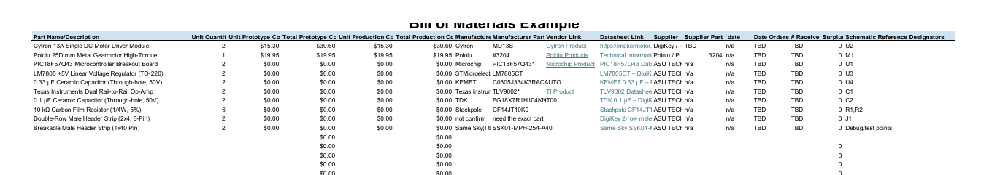

#  Official Bill of Materials Document

Access the official document or download the high-resolution vector PDF below.

## Live Spreadsheet Grid
Below is the direct visual export from the project spreadsheet system:

---

# Estimated Component Budget & Conclusion

For component pricing details, please refer to the respective suppliers. Board 2 controls the gripper actuator, monitors motor load, and communicates operating status to the bus master. Verify component ratings and safety protocols prior to final implementation.

## Resources
The bill of materials as a PDF download is available [here](BOM.pdf).

