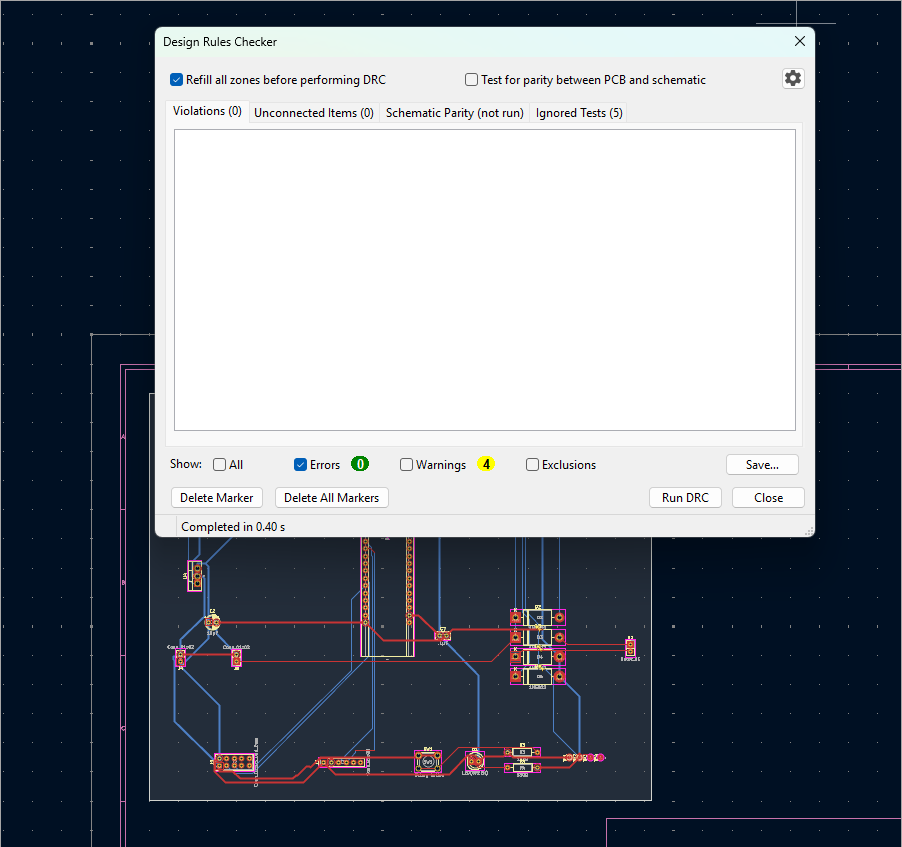
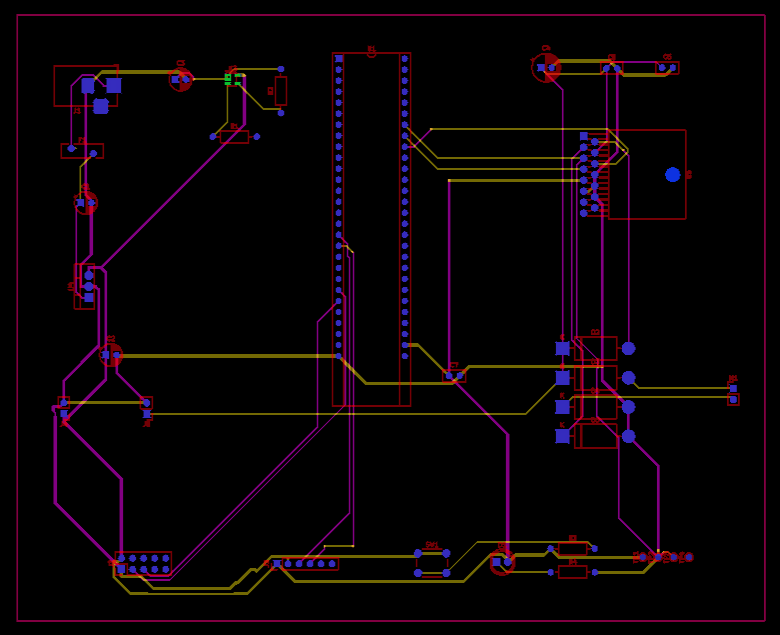

## Overview

This printed circuit board (PCB) implements the physical two-layer layout for the **Grip Actuation Node subsystem**.
* **Board Architecture:** Two-layer (`F.Cu` and `B.Cu`) through-hole and surface-mount mixed design built around the 56-pin Microchip PIC18F57Q43 Curiosity Nano footprint (`U1`) and L298HN H-bridge motor driver (`U5`).
* **Layout & Isolation:** Separates high-current +12V motor drive traces and flyback protection diodes (`D2`–`D5`) on the right edge from low-noise analog overcurrent sensing (`U3`) and +5V logic regulation (`U4`) on the left.
* **Verification:** Passed KiCad Design Rules Check (DRC) with zero errors and zero unconnected nets, and verified for manufacturability via JLCDFM analysis.

*Figure 1: Completed two-layer PCB layout for the Grip Actuation Node.*

## Design Verification

*Figure 2: KiCad Design Rules Checker (DRC) report confirming zero errors and zero unconnected items.*

*Figure 3: JLCDFM board preview and Design for Manufacturability (DFM) verification report.*

## Resources

The PCB layout as a PDF download is available [here](./PCB_Grip_Actuation_Node.pdf).
The fabrication Gerber and Drill files are available as a ZIP archive [here](./Garcia_Emmanuel_Team104.zip).
