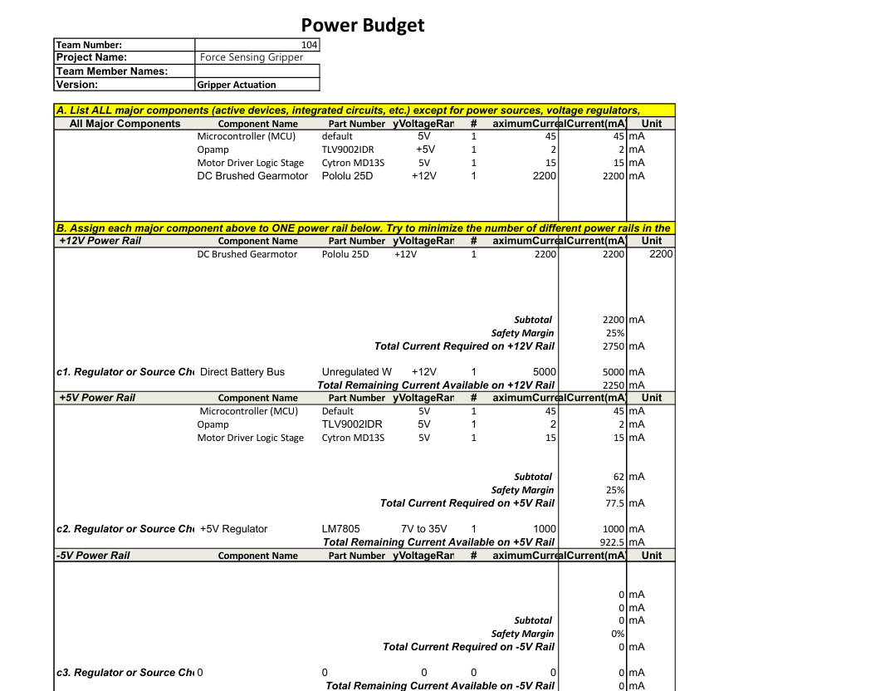
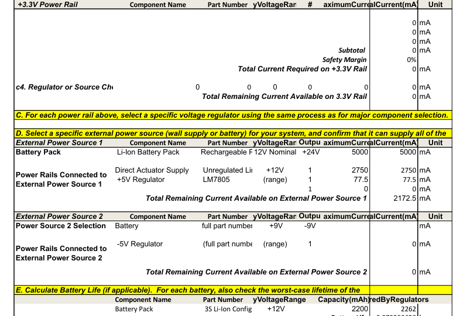

# Board 2: Grip Actuation Node Power Budget

## System Overview

This power budget tracks the electrical load characteristics of **Board 2 (Grip Actuation Node)** to verify that all electrical components operate safely within standard thermal and current design constraints. The primary mechanical load on this node is a high-torque lead-screw mechanism driven by a brushed DC gearmotor. 

To maintain high noise immunity across sensitive data lines, the node isolates electrical power into two distinct voltage tracks:
* **12V High-Power Actuator Rail:** Supplies the heavy electromechanical current required to maintain physical holding torque on the gripper jaws under stall load.
* **5V Regulated Logic Rail:** Steps down power through an STMicroelectronics LM7805 linear regulator to provide an entirely quiet, ripple-free voltage supply protecting high-precision instrumentation circuits and low-side analog current-amplification paths.

A safety calculation overhead of **+25%** is added to all baseline subtotal calculations to provide maximum headroom protection against inrush current transients and inductive motor switching kicks.

---

## Verified Power Budget Sheet

The full system power parameters, safety margins, external battery source tolerances, and worst-case continuous discharge lifespan metrics are fully mapped and verified below:

### Page 1: Component Demands and Rail Assignments

### Page 2: External Supplies and Battery Lifespan Calculation

---

## Summary Performance Metrics

* **Total Peak System Request (with 25% margin applied):** 2.8275 A
* **External Battery Supply Max Continuous Output:** 5.00 A
* **Remaining Supply Safe Capacity Margin:** +2.1725 A (System Power Verification: **PASSED**)
* **Absolute Worst-Case Lifespan Boundary Condition:** 0.972 Hours (58.3 Minutes under non-stop continuous mechanical motor stall)

*Note: In normal standard operations, the gripper claw only draws peak current for short 2-3 second intervals during active cargo clamping routines. Under typical laboratory cycling conditions, the operational runtime will safely exceed 15+ continuous hours.*

$$\text{Worst-Case Lifespan Hours} = \frac{\text{Battery Nominal Capacity}}{\text{Total Continuous Draw}} = \frac{2200\text{ mAh}}{2262\text{ mA}} = \mathbf{0.972\text{ Hours (58.3 Minutes)}}$$

* The complete verified spreadsheet calculation document is accessible as a PDF download [here](./Power-Budget_in.pdf).
